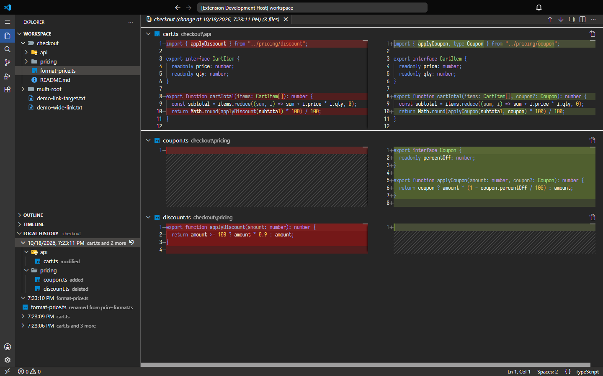

# Simplysm Local History

> 🇰🇷 한국어 설명은 [아래](#한국어-korean)에 있습니다.

Records every change to your workspace files, shows what each change did as a before/after diff, and restores files or folders to just before a change — like WebStorm's Local History.

Git only protects what you commit. This extension records your files as you change them, so you can restore files after a bad refactor, an accidental delete, or a botched move + undo, even if you never committed. Unlike the built-in Timeline, it also works on **folders** — see what changed across a whole folder and restore it.

## Features

- **Automatic recording** — changes are recorded in the background as you work, including changes made outside VS Code. Bursts like `git checkout` or `npm install` are grouped into one change.
- **History of a file or a folder** — right-click a file *or folder* in the Explorer → **Show History**. The **Local History** view lists the changes, newest first.
  - Each change shows its time. In a folder's history it also names the changed files.
  - Expand a change in a folder's history to see its files as a folder tree, each marked *added*, *deleted*, *modified*, *renamed from …*, or *moved to …*.
  - The first 100 changes are shown. **Load more…** at the end of the list shows the next 100.
- **Before ↔ after diff** — select a change to compare the state just before it (left) with the state just after it (right) in the built-in diff editor. A folder's change opens as a multi-file diff.
  - Select a range (Shift+click) to compare the state just before its earliest change with the state just after its latest change. To compare with your current files, select a range from the top change down to the change you want.
  - Select files or folders under a change to compare only those.
  - Every file type is shown the way VS Code shows the current file: binary files get VS Code's binary-file notice, images are shown side by side, and text follows your encoding settings (`files.encoding`). There is no size limit.
- **Open in the default app** — for formats VS Code can't show (Excel, PDF, …), right-click a change in a file's history, or a file under a change in a folder's history → **Open in Default App (Before This Change)** or **(After This Change)**. A read-only copy opens, so your files and history stay as they are. Not available in remote sessions (Remote-SSH, WSL, containers).
- **Restore only what you pick** — click **Restore to Before This Change** on a change, a selected range, a folder, or files under a change. Only those files go back to the state just before the change; later changes to other files stay. Files created by the change are deleted, and files deleted by it come back.
  - A confirmation first shows how many files will change and how many will be deleted. If any of them has unsaved edits, it says those edits will be saved first.
  - The current state is recorded right before restoring, and the restore itself is recorded as a change — so you can restore a restore, too.
- **Renames** — a file's history continues across renames. In a folder's history, restoring a rename puts the file back under its old name.
- **Keeps your repo clean** — history is stored outside the workspace; nothing is added to your Git repository. History is kept for one year.
- **Exclude files** — the `simplysm-local-history.exclude` setting adds glob patterns on top of `files.exclude` and `files.watcherExclude`. On startup, matching files are also removed from existing history.
- English/Korean UI.

Note: changes made while VS Code is closed are not recorded one by one — on startup, only the resulting state of each changed file is recorded.

---

한국어 (Korean)

워크스페이스 파일의 모든 변경을 기록하고, 변경마다 무엇이 바뀌었는지 직전 ↔ 직후 diff로 보여 주며, 파일·폴더를 변경 직전으로 복원합니다 — WebStorm의 Local History와 같은 역할입니다.

Git은 커밋한 것만 지켜줍니다. 이 확장은 파일이 바뀔 때마다 기록하므로, 잘못된 리팩토링, 실수로 한 삭제, 꼬여버린 이동+undo 뒤에도 커밋한 적이 없는 파일을 복원할 수 있습니다. 내장 Timeline과 달리 **폴더**에도 쓸 수 있습니다 — 폴더 전체에서 무엇이 바뀌었는지 보고 복원합니다.

### 기능

- **자동 기록** — 작업하는 동안 변경이 백그라운드에서 기록됩니다. VS Code 밖에서 바꾼 것도 기록됩니다. `git checkout`이나 `npm install` 같은 대량 변경은 변경 하나로 묶입니다.
- **파일·폴더의 이력** — Explorer에서 파일 *또는 폴더*를 우클릭 → **이력 보기**(Show History). **로컬 이력** 뷰에 변경이 최신순으로 나열됩니다.
  - 변경마다 시각이 보입니다. 폴더의 이력에서는 바뀐 파일 이름도 보입니다.
  - 폴더의 이력에서 변경을 펼치면 그 변경의 파일이 폴더 트리로 보이고, 파일마다 *생성됨*, *삭제됨*, *수정됨*, *…에서 이름 변경*, *…(으)로 이동* 이 표시됩니다.
  - 처음에는 변경 100개가 보입니다. 목록 끝의 **더 보기…** 를 누르면 다음 100개가 보입니다.
- **변경 직전 ↔ 직후 diff** — 변경을 고르면 그 변경 직전 상태(왼쪽)와 직후 상태(오른쪽)를 내장 diff 에디터로 비교합니다. 폴더의 변경은 다중 파일 diff로 열립니다.
  - 범위를 고르면(Shift+클릭) 범위에서 가장 이른 변경의 직전 상태와 가장 늦은 변경의 직후 상태를 비교합니다. 지금 파일과 비교하려면 맨 위 변경부터 원하는 변경까지 범위를 고릅니다.
  - 변경 아래의 파일이나 폴더를 고르면 그것만 비교합니다.
  - 모든 파일 형식을 VS Code가 지금 파일을 보이는 방식대로 보입니다. 이진 파일은 VS Code의 이진 파일 안내가 뜨고, 이미지는 나란히 보이며, 텍스트는 인코딩 설정(`files.encoding`)을 따릅니다. 크기 제한은 없습니다.
- **기본 앱으로 열기** — VS Code가 보여 주지 못하는 형식(엑셀, PDF 등)은, 파일의 이력에서 변경을 우클릭하거나 폴더의 이력에서 변경 아래의 파일을 우클릭 → **기본 앱으로 열기 (이 변경 직전)** 또는 **(이 변경 직후)**. 읽기 전용 사본이 열리므로 작업 파일과 이력은 그대로입니다. 원격 작업(Remote-SSH, WSL, 컨테이너)에서는 쓸 수 없습니다.
- **고른 것만 복원** — 변경, 고른 범위, 변경 아래의 폴더나 파일에서 **이 변경 직전으로 복원** 버튼을 누릅니다. 고른 파일만 그 변경 직전 상태로 돌아가고, 그 뒤에 바뀐 다른 파일은 그대로입니다. 그 변경에서 생긴 파일은 지워지고, 그 변경에서 삭제된 파일은 되살아납니다.
  - 먼저 확인 창이 바뀔 파일 수와 지워질 파일 수를 알려 줍니다. 그중 미저장 편집이 있는 파일이 있으면, 그 편집을 먼저 저장한다고 알려 줍니다.
  - 복원 직전 지금 상태가 기록되고, 복원 자체도 변경으로 기록됩니다 — 그래서 복원도 다시 복원할 수 있습니다.
- **이름 변경** — 파일의 이력은 이름을 바꿔도 이어집니다. 폴더의 이력에서 이름 변경을 복원하면 파일이 옛 이름으로 돌아갑니다.
- **저장소를 깨끗하게** — 이력은 워크스페이스 밖에 저장되며, Git 저장소에는 아무것도 추가되지 않습니다. 이력은 1년간 보관됩니다.
- **제외 설정** — `simplysm-local-history.exclude` 설정으로 `files.exclude`, `files.watcherExclude`에 더해 제외할 glob 패턴을 정합니다. 기동 시 패턴에 걸리는 파일은 기존 이력에서도 지워집니다.
- 영어/한국어 UI 지원.

참고: VS Code가 꺼져 있는 동안의 변경은 하나하나 기록되지 않습니다 — 기동 시 바뀐 파일마다 그 결과 상태만 기록됩니다.

